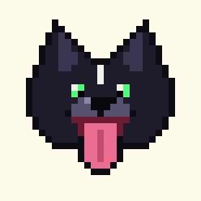
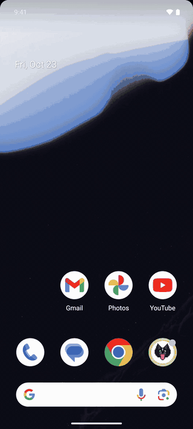
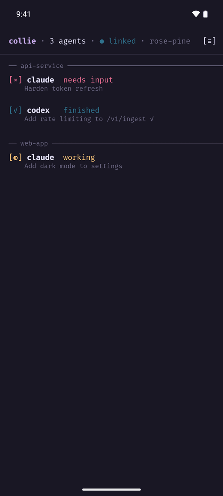
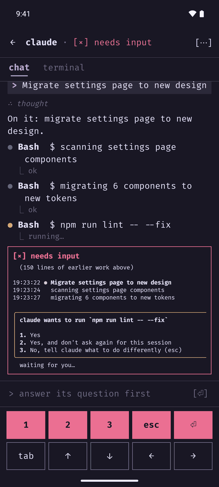
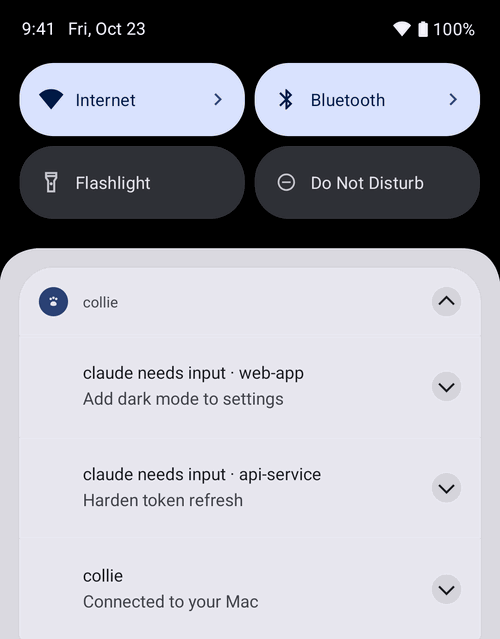
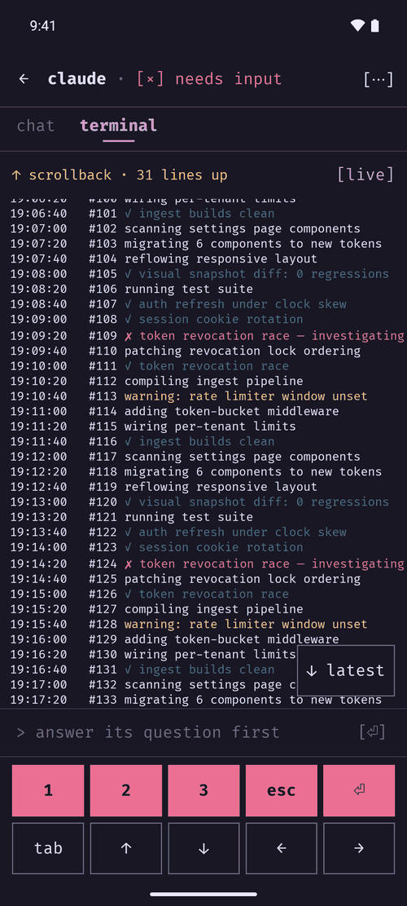
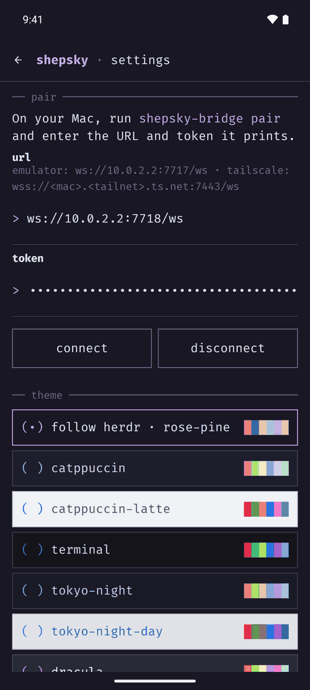
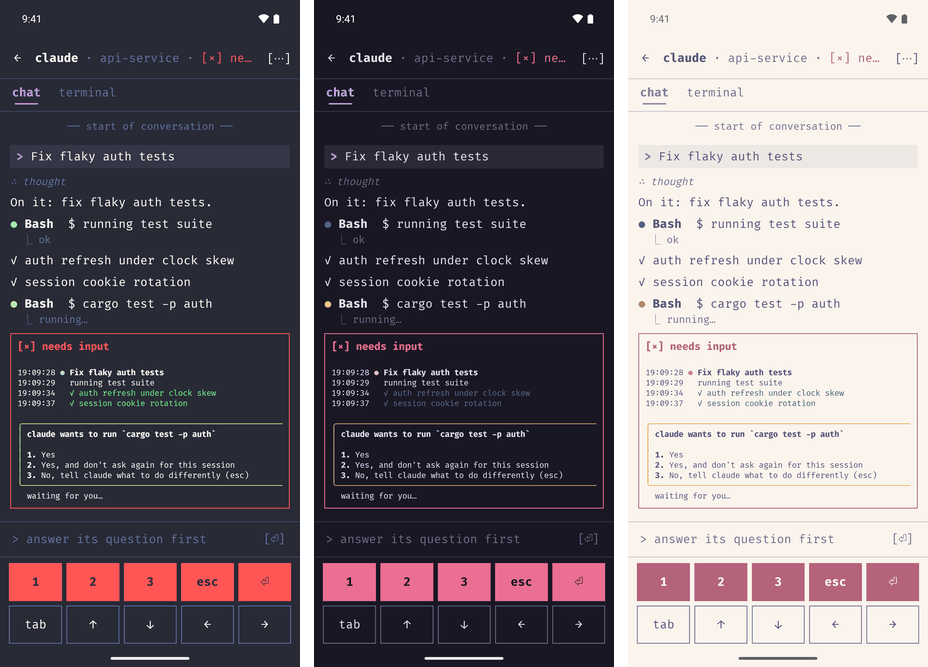

<p align="center"></p>

<h1 align="center">shepsky</h1>

<p align="center">
Watch and answer your <a href="https://herdr.dev">herdr</a> coding agents from your phone.<br>
Half shepherd, half husky: a shepsky keeps an eye on the herd and runs the news back to you.
</p>

<p align="center">
  
  
  
</p>

Your agents run in herdr on your Mac. shepsky puts them in your pocket:

- **See every agent at a glance** — which are working, which finished, which
  are stuck waiting on you.
- **Get notified** the moment an agent needs input or finishes, even with the
  app closed (and after a reboot).
- **Unblock with one tap** — a notification opens the agent with its latest
  output on screen, so you read the question before answering 1/2/3/Enter/Esc.
- **Read the conversation, not just the screen** — prompts, replies, tool
  calls and their results, from each agent's own transcript (Claude Code,
  Codex, pi), with the whole history a scroll away. The live terminal is one
  tab over.
- **Send new prompts** and **watch the live terminal**, in your herdr theme.
- **Start a new agent** (claude, codex or pi) in a new workspace or a new tab
  of an existing one, right from the phone; long-press one to rename or
  close it.
- **Private by design** — your Mac talks to your phone directly (ideally over
  your tailnet). No cloud, no account, no third server.

<p align="center">
  
  
</p>

```
┌─────────── Mac ───────────┐          ┌───── Android ─────┐
│ herdr ⇄ shepsky-bridge    │ ws(s)/   │ Rust core (JNI)   │
│         (Rust, :7717)     │ tailnet  │  ⇄ Compose app    │
└───────────────────────────┘          └───────────────────┘
```

## Try it on your Mac (no phone, no real agents)

```sh
scripts/try-it.sh
```

This boots an Android emulator on your Mac (creating it the first time),
builds and installs the app, and starts a **demo**: three fake agents in a
sandboxed herdr session, separate from your real one, that spend no tokens.
The app opens with pairing filled in; tap **Connect**. Then:

- tap an agent that **needs input** and answer it with **1 / 2 / 3**;
- send an idle agent a prompt and watch it work in the terminal;
- leave the app: notifications arrive when an agent needs you.

`scripts/try-it.sh down` stops the demo and the emulator. The script installs
the missing Android SDK packages, `cargo-ndk` and the Rust Android target
itself; you need herdr, Rust, Node and a JDK (see below). The first run
downloads a few GB (SDK, emulator image, Gradle); later runs take seconds.

## Requirements

- **Mac**: herdr ≥ 0.9.5, Rust (stable), Node.js (for the demo only).
- **Building the app** (`try-it.sh` sets up everything but the JDK):
  - a JDK 17–21: `brew install --cask temurin@21`
  - the Android SDK with `platform-tools`, `platforms;android-35`,
    `build-tools;35.0.0` and an NDK (`ndk;27.3.13750724`), via Android Studio
    or `brew install --cask android-commandlinetools`. Gradle finds it through
    `ANDROID_HOME` or `android/local.properties` (`sdk.dir=…`).
  - `cargo install cargo-ndk` and `rustup target add aarch64-linux-android`
  - build with the bundled `android/gradlew`, not Homebrew's `gradle` (Gradle 9
    can't run this Android plugin).
- **Phone**: Android 12+. Tailscale on both devices is the recommended
  transport.

## Quick start

**1. Start the bridge on your Mac** (where herdr runs):

```sh
cargo install --path crates/shepsky-bridge   # puts shepsky-bridge on your PATH
shepsky-bridge serve
```

(or straight from the repo: `cargo run --release -p shepsky-bridge -- serve`). It binds `127.0.0.1:7717` and prints what it's doing. `shepsky-bridge status
--watch` gives you the same live view in the terminal, no phone needed.

**2. Expose it to your phone** (pick one):

| Phone is… | URL to pair with | Setup |
|---|---|---|
| Android emulator on the Mac | `ws://10.0.2.2:7717/ws` | nothing |
| On your tailnet (recommended) | `wss://<mac>.<tailnet>.ts.net:7443/ws` | `tailscale serve --bg --https=7443 http://127.0.0.1:7717` |
| Same Wi-Fi | `ws://<mac-LAN-IP>:7717/ws` | `shepsky-bridge serve --bind 0.0.0.0:7717` — token is the only gate, prefer Tailscale |

Never expose the port publicly (`tailscale funnel`, port-forwards). Port 7443
keeps the bridge tailnet-only even if you already serve other things: Funnel
only works on 443, 8443 and 10000, so a bridge on 7443 can't end up public by
accident (check with `tailscale serve status`).

**3. Build + install the app** (phone in developer mode, USB attached):

```sh
cd android
JAVA_HOME=$(/usr/libexec/java_home -v 21) ./gradlew installRelease
```

The release build is about 4 MB. It's signed with Android's debug key, so it
installs over a debug build in place; publishing it anywhere would need a real
signing key. `installDebug` still works for development.

**4. Pair.** Run `shepsky-bridge pair` on the Mac, type the URL + token into
the app, hit Connect. Done — the overview fills in, and notifications arrive
from your agents.



Opening `shepsky://pair?url=<url-encoded URL>&token=<token>` on the phone fills
in the pairing screen for you (it never connects until you tap Connect).

## Themes

shepsky looks like what it is, a herdr client: a terminal, not a Material app.
It follows herdr's theme (the bridge reads `[theme]` from herdr's
`config.toml`, auto-switch included), or you can pick any of herdr's 18
built-in themes in Settings. Terminal output is drawn with the theme's own 16
colors.

<p align="center">
  
</p>

## The demo, piece by piece

`try-it.sh` is a wrapper around `scripts/demo-session.sh`, which you can run on
its own (e.g. with your own emulator or phone):

```sh
scripts/demo-session.sh up     # demo herdr session + fake agents + bridge on :7718
scripts/demo-session.sh down
```

- The demo runs its own herdr session (`shepsky-demo`) and its own bridge on
  port 7718, so your real session and a real bridge on 7717 are untouched.
- The fake agents (`scripts/fake-agent.mjs`) report their state to herdr like
  a real integration. They work through a task, sometimes stop to ask
  permission (answer with 1/2/3/Enter/Esc), and take new prompts when idle.
- Agents you start from the app in the demo are fake ones too (the bridge's
  `--demo-agent`).
- The demo bridge runs with `--demo`. herdr only delivers agent input to a
  **real** agent process (see Security), which a Node script isn't, so the demo
  bridge types into the demo panes directly instead. It still refuses prompts
  while an agent is asking a question, like herdr does. Never use `--demo` on
  your real session.
- If an emulator with the app is running, `up` fills in its pairing screen.
  Otherwise pair with `ws://10.0.2.2:7718/ws` and the token it prints.

## Repo layout

| path | what |
|---|---|
| `crates/shepsky-core` | shared Rust: herdr types, session store, notification dedup, protocol, ANSI→styled frames |
| `crates/shepsky-bridge` | Mac daemon: herdr socket sync + phone WebSocket server (`serve`, `status`, `pair`) |
| `crates/shepsky-android` | Rust cdylib behind a 3-function JNI surface |
| `android/` | Kotlin + Jetpack Compose app |
| `scripts/` | `try-it.sh` (emulator + app + demo), `demo-session.sh` + `demo.mjs` + `fake-agent.mjs` (the demo), `smoke.mjs` (fake phone) |
| `docs/PROTOCOL.md` | bridge ↔ phone protocol |
| `docs/herdr-notes.md` | verified herdr socket facts and sharp edges |
| `docs/images/` | README screenshots and the icon |
| `third_party/` | licenses for bundled assets (Fira Code) |

## Security model

- **The bridge is the gatekeeper.** herdr's socket accepts input injection
  from anyone who can open it, so the bridge binds loopback only, requires a
  bearer token (`~/.config/shepsky/token`, created on first run, 0600) as the
  first message of every connection, and only ever calls an explicit
  allowlist of herdr methods: reads plus `agent.prompt`, `agent.send_keys`,
  `agent.focus`, `pane.send_keys` and `pane.send_text`, and for starting
  agents `workspace.create`, `tab.create`, `agent.start` (plus
  `workspace.close`/`tab.close`, only to undo a start that failed), and
  `agent.rename`, `pane.rename` and `pane.close` to rename and close agents.
- **shepsky can't type into a shell.** Prompts go through herdr's
  `agent.prompt` and keys through `agent.send_keys`. herdr only delivers them
  when the pane's foreground process really is that agent, and refuses a
  prompt while the agent is waiting on a question. If the agent has exited
  and left a shell behind, nothing is typed; the app says so. The pane-level
  methods are used only by `--demo`, for the sandboxed demo session.
- **Conversations come from the agents' own logs.** The chat view reads the
  transcript herdr's integration points to, and only inside that agent's
  folder (`~/.claude/projects`, `~/.codex/sessions`, `~/.pi/agent/sessions`);
  the phone asks for a pane, never a file. Transcripts hold more than the
  screen (full tool output, the agent's thinking when it shares it), so the
  token guards that too.
- **Closing ends an agent.** Long-press an agent to rename or close it.
  Closing is only allowed on panes that host an agent (herdr confirms it
  right before), never a plain shell, and the app asks first. Anyone holding
  your token can end your agents, as well as start them.
- **Starting agents is fenced in.** The phone can start only claude, codex
  or pi, with no command-line arguments (so no flags that skip their
  permission prompts), and only in an existing directory inside your home
  folder. The bridge checks all of this; the app only asks. Anyone holding
  your token can start agents, so guard it like an SSH key.
- **Remote access rides your tailnet.** Tailscale authenticates the devices
  and encrypts the transport, and `tailscale serve` adds real TLS. Never use
  `tailscale funnel` or a port-forward.
- **On the phone**, the token lives in app-private preferences. Cleartext
  `ws://` is allowed on purpose for the emulator and in-tailnet use; don't use
  it over networks you don't trust. A pairing link only fills in the form:
  check the URL before you tap Connect.

## Status

0.1. Known gaps: the terminal tab mirrors the screen but isn't a full
terminal (no scrollback there; the chat tab has the history). The chat view
covers Claude Code, Codex and pi; other agents get the terminal. Codex
doesn't tell herdr which conversation a pane is in, so the bridge works it
out from the directory, the thread name and what's on screen; a codex that
hasn't started a conversation yet shows the terminal. One bridge per herdr session; per-agent mutes and QR pairing
aren't built yet. Notifications are live only: if an agent finishes or starts asking
while your phone is offline, the overview catches up when it reconnects, but
you won't get a notification for it. Opening a *finished* agent marks it seen, which also switches herdr
on your Mac to that agent's tab. The protocol may change before 1.0
(`PROTO_VERSION` guards it).

## Credits

- [Fira Code](https://github.com/tonsky/FiraCode) by Nikita Prokopov, bundled
  under the SIL Open Font License (`third_party/fira-code/OFL.txt`).
- Terminal palettes from
  [iTerm2-Color-Schemes](https://github.com/mbadolato/iTerm2-Color-Schemes)
  (MIT) and the themes' own authors; accents from herdr.

## License

MIT
